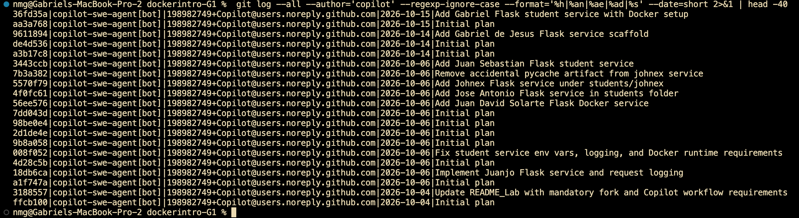
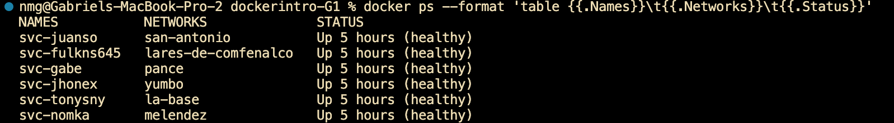
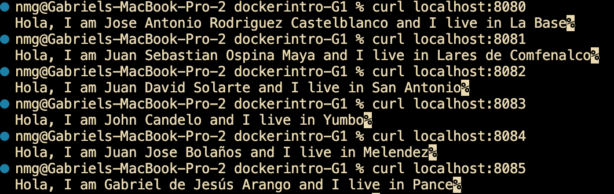
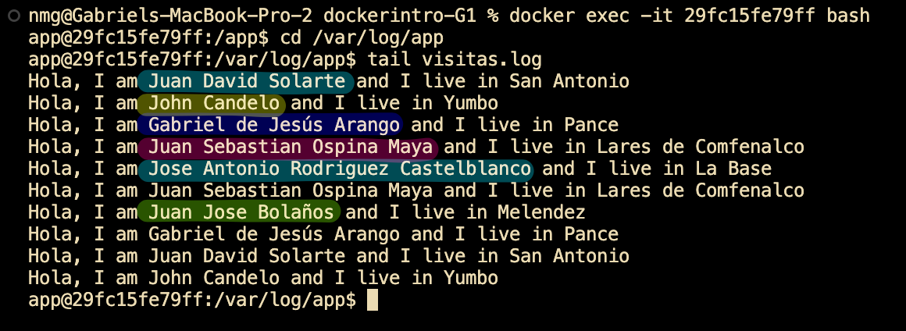

# 📌 Deliverables

- ✅ **A folder in the team fork `/students/<your-name>/` with Dockerfile, code, and dependencies.**
  The folders with the Dockerfile and code already exist.

- ✅ **Your own GitHub Issue with complete service requirements.**
  - Jose Antonio — https://github.com/Nomka0/dockerintro-G1/issues/2
  - Juan Sebastian Ospina Maya — https://github.com/Nomka0/dockerintro-G1/issues/3
  - Juan Solarte — https://github.com/Nomka0/dockerintro-G1/issues/4
  - Juan José Bolaños — https://github.com/Nomka0/dockerintro-G1/issues/6
  - John Candelo — https://github.com/Nomka0/dockerintro-G1/issues/8
  - Gabriel Arango — https://github.com/Nomka0/dockerintro-G1/issues/19

- ✅ **Evidence of Copilot participation in your task.**
  The participation of the Copilot coding agent in the project can be checked through the filtering of its git commits on the group project repository.

  

- ✅ **Your Pull Request linked to the Issue.**
  - Jose Antonio — Issue #2 → PR #12 — https://github.com/Nomka0/dockerintro-G1/pull/12
  - Juan Sebastian Ospina Maya — Issue #3 → PR #11 — https://github.com/Nomka0/dockerintro-G1/pull/11
  - Juan David Solarte — Issue #4 → PR #10 — https://github.com/Nomka0/dockerintro-G1/pull/10
  - Juan José Bolaños — Issue #6 → PR #7 — https://github.com/Nomka0/dockerintro-G1/pull/7
  - John Candelo — Issue #8 → PR #9 — https://github.com/Nomka0/dockerintro-G1/pull/9
  - Gabriel Arango — Issue #19 → PR #20 — https://github.com/Nomka0/dockerintro-G1/pull/20

- ✅ **A published Docker image (Docker Hub or GitHub Packages).**
  - Jose Antonio — https://hub.docker.com/r/tonysny/cali-service
  - Juan Sebastian Ospina Maya — https://hub.docker.com/r/fulkns645/cali-service
  - Juan David Solarte — https://hub.docker.com/r/juanso1999/cali-service
  - Juan José Bolaños — https://hub.docker.com/r/nomka/cali-service
  - John Candelo — https://hub.docker.com/r/jhonex7/cali-service
  - Gabriel Arango — https://hub.docker.com/r/garanguv/cali-service
  - Screenshots of each Docker Hub page: `deliverables/dockerhub/`

- ✅ **A working container in your chosen neighborhood.**
  

- ✅ **Evidence of successful image build and published image.**
  Each image was built from its own Dockerfile and pushed to Docker Hub, where it is now ready to run. The published images are listed above under the published Docker image deliverable (with a screenshot of each Docker Hub page), confirming the build completed successfully and the image is available in the registry.

- ✅ **Evidence of network connectivity test.**
  

- ✅ **Evidence that your service wrote to La Biblioteca del Pueblo.**
  

- ✅ **Short explanation of your design choice (Python, Node.js, Nginx, etc).**
  We decided to use the same programming stack (Python/Flask) to enhance collaboration between our team members. We used copilot to develop the core functionalities of the application and switched to pair programming when we faced problems for file access due to a race condition regarding access. We solved this issue by enforcing the same UID (1000) throughout all of the Docker images by editing their respective Dockerfiles.

- ✅ **(Optional) Use your own names for networks, images, and containers to make the demo personal.**
  Custom names were used throughout — networks named after Cali neighborhoods, `svc-*` container names, and personalized Docker Hub image tags.
